<div align="center">
  
  <h1>📚 ProReach: System Architecture & Engineering Specification</h1>
  <p><b>An In-Depth Blueprint of Frictionless Multi-Tenant Architecture, Dynamic Cryptography, and AI Orchestration</b></p>

  <div>
    
    
    
    
    
  </div>
</div>

---

## 📑 Table of Contents

1. [Executive Summary & System Vision](#-1-executive-summary--system-vision)
2. [End-to-End Architectural Blueprint](#-2-end-to-end-architectural-blueprint)
3. [Frictionless Onboarding & Hardware-Anchored Identity](#-3-frictionless-onboarding--hardware-anchored-identity)
4. [Cryptographic Vault: Dynamic Key Derivation](#-4-cryptographic-vault-dynamic-key-derivation)
5. [AI Orchestration Engine (Google Gemini 1.5)](#-5-ai-orchestration-engine-google-gemini-15)
6. [Responsive HTML Templating Engine](#-6-responsive-html-templating-engine)
7. [Asynchronous Non-Blocking Dispatch & Concurrency](#-7-asynchronous-non-blocking-dispatch--concurrency)
8. [Application Lifecycle & Funnel State Machine](#-8-application-lifecycle--funnel-state-machine)
9. [Complete REST API Specification](#-9-complete-rest-api-specification)
10. [Relational Data Model & Entity Specifications](#-10-relational-data-model--entity-specifications)
11. [Mobile Client Architecture & UX System](#-11-mobile-client-architecture--ux-system)
12. [Cross-Platform Ecosystem & Future Roadmap](#-12-cross-platform-ecosystem--future-roadmap)
13. [Infrastructure Scaling & Persistence Migration Plan](#-13-infrastructure-scaling--persistence-migration-plan)
14. [Local Development & Environment Setup](#-14-local-development--environment-setup)

---

## 🧭 1. Executive Summary & System Vision

### The Problem Space
In the modern software engineering employment market, standard cold applications yield an abysmal response rate (< 2%). Conversely, deeply researched, customized pitches mapping specific company requirements directly to candidate strengths boast response rates upwards of 25–40%. However, manually analyzing job descriptions, formulating personalized narratives, formatting professional email layouts, and tracking communications takes **30–45 minutes per application**, leading to severe candidate burnout.

### The ProReach Solution
**ProReach** is a high-velocity, privacy-first career outreach platform engineered to eliminate application friction. It acts as an automated, intelligent co-pilot that:
1. Ingests raw job descriptions and company context.
2. Extracts candidate skills, achievements, and experiences directly from an uploaded PDF resume and local developer profile.
3. Synthesizes a hyper-personalized, context-aware cold pitch via **Google Gemini 1.5 Flash** using dynamic cognitive angle selection.
4. Encapsulates the narrative within responsive HTML email designs.
5. Dispatches the email directly from the developer’s authenticated Gmail SMTP account in a non-blocking background thread with resume attachment.

```
┌─────────────────────────────────────────────────────────────────────────────┐
│                           CORE DESIGN PRINCIPLES                            │
├─────────────────────┬──────────────────────┬────────────────────────────────┤
│ 🚀 Zero-Friction    │ 🔐 Zero-Knowledge    │ ⚡ High Concurrency            │
│ No tedious sign-ups,│ Dynamic cryptographic│ Async background dispatching   │
│ passwords, or JWTs. │ keys per tenant;     │ ensures mobile UI stays 60 FPS │
│ Device-bound UUIDs. │ secrets never stored │ without network thread stalls. │
│                     │ in plaintext.        │                                │
└─────────────────────┴──────────────────────┴────────────────────────────────┘
```

---

## 🏛️ 2. End-to-End Architectural Blueprint

ProReach employs a decoupled **Client-Server Architecture** featuring a React Native / Expo front-end communicating with a headless Django REST Framework API back-end.

### High-Level Topology Diagram

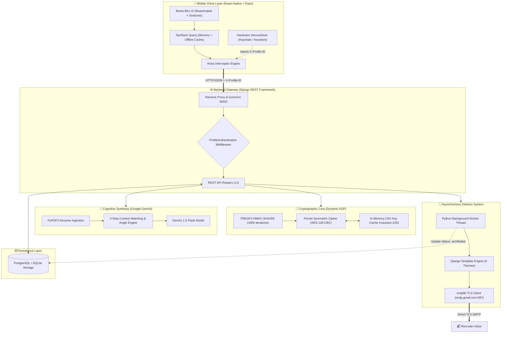

### Full-Stack Data Flow Animation

The diagram below illustrates the exact interactive path traveled from candidate input to inbox delivery:

<div align="center">
  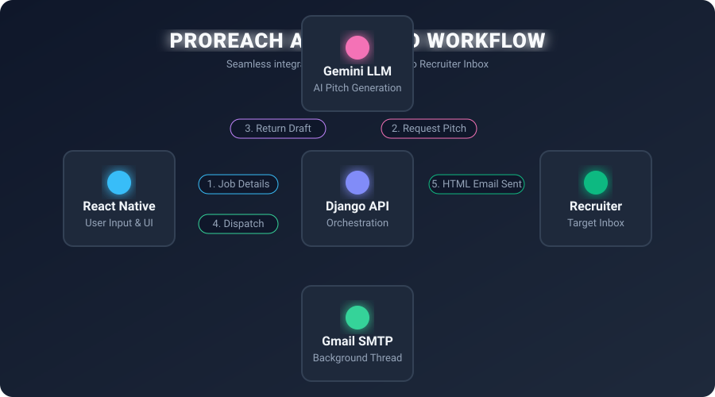
</div>

---

## 🚀 3. Frictionless Onboarding & Hardware-Anchored Identity

### The Philosophy: Zero-Friction Device Binding
Traditional web and mobile applications require email verifications, passwords, OAuth redirects, and JWT refresh token handshakes before a user can test a single feature. This creates high bounce rates and compromises personal privacy.

ProReach replaces traditional authentication with a **Hardware-Anchored Device Identity Protocol**:

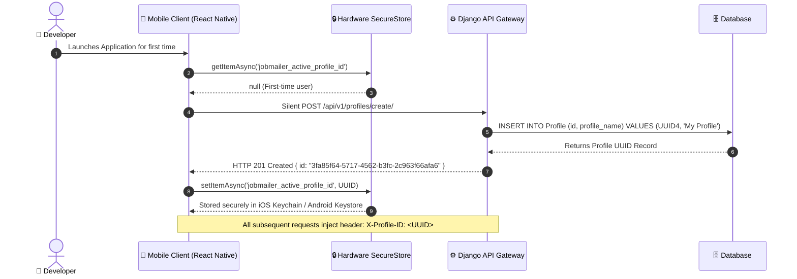

### ProfileAuthentication Middleware
Every protected endpoint evaluates the custom `ProfileAuthentication` backend class:

```python
class ProfileAuthentication(BaseAuthentication):
    def authenticate(self, request):
        profile_id_str = request.headers.get('X-Profile-ID')
        if not profile_id_str:
            return None  # Unauthenticated request

        try:
            profile_id = uuid.UUID(profile_id_str)
            profile = Profile.objects.get(id=profile_id)
        except (ValueError, Profile.DoesNotExist):
            raise AuthenticationFailed('Invalid or missing Profile ID')

        request.profile = profile
        return (profile, None)
```

### Orphaned UUID Self-Healing Mechanism
When running on cloud providers with ephemeral filesystems (e.g., Render free tier) where database state can reset upon redeployments, the client's stored UUID might no longer exist on the server. Instead of freezing or crashing into unhandled 500/404 screens, ProReach implements an **Axios Interceptor Self-Healing Protocol**:

```typescript
// frontend/src/services/api.ts
api.interceptors.response.use(
  (response) => response,
  async (error) => {
    if (error.response && [401, 403, 404].includes(error.response.status)) {
      console.warn("Backend rejected Profile ID (Server reset). Wiping SecureStore...");
      await SecureStore.deleteItemAsync('jobmailer_active_profile_id');
      Alert.alert(
        "Session Reset",
        "Your profile state was renewed by the server. Please restart to re-initialize your local profile."
      );
    }
    return Promise.reject(error);
  }
);
```

---

## 🔐 4. Cryptographic Vault: Dynamic Key Derivation

### The Vulnerability of Global Master Keys
Most applications that store third-party credentials (such as Gmail App Passwords and LLM API keys) encrypt database columns using a single, static master encryption key (e.g., `settings.SECRET_KEY`). If the database or server environment is compromised, every user's external credentials are leaked simultaneously.

### ProReach Dynamic Per-Tenant Isolation
ProReach utilizes **Dynamic Key Derivation** where each user profile possesses its own mathematically distinct cryptographic key derived on-the-fly.

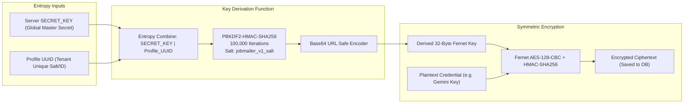

### Mathematical & Cryptographic Formulation
The derived key $K_{profile}$ for a tenant with profile ID $P$ is expressed as:

$$RawEntropy = SECRET\_KEY \mathbin{\Vert} P$$

$$K_{profile} = \text{Base64URLSafe}\Big(\text{PBKDF2}\big(\text{PRF}=\text{HMAC-SHA256},\ S=b'\text{jobmailer\_v1\_salt}',\ c=100{,}000,\ dkLen=32,\ PWD=RawEntropy\big)\Big)$$

### Performance Optimization: LRU Key Caching
Deriving keys via 100,000 iterations of PBKDF2 is intentionally CPU-intensive to mitigate brute-force attacks. Doing this repeatedly per HTTP request would severely degrade API throughput. ProReach utilizes an in-memory Least Recently Used (LRU) cache:

```python
# backend/jobmailer/mailer/encryption.py
@lru_cache(maxsize=100)
def _derive_profile_key(profile_id: str) -> Fernet:
    raw = f"{settings.SECRET_KEY}|{profile_id}"
    kdf = PBKDF2HMAC(
        algorithm=hashes.SHA256(),
        length=32,
        salt=b'jobmailer_v1_salt',
        iterations=100_000,
    )
    key = base64.urlsafe_b64encode(kdf.derive(raw.encode('utf-8')))
    return Fernet(key)
```
> [!NOTE]
> The `@lru_cache` guarantees that active tenant sessions execute encryption/decryption in sub-millisecond time while retaining complete multi-tenant cryptographic isolation.

### Defensive Credential Sanitization
Google App Passwords generated in Google Accounts are formatted with spaces (e.g. `abcd efgh ijkl mnop`). If passed unformatted to an SMTP socket, authentication fails abruptly with an `SMTPAuthenticationError`. ProReach performs defensive sanitization:
* Automatically strips whitespace formatting: `app_password.replace(" ", "")`.
* Trims leading and trailing control characters before derivation and dispatch.

---

## 🧠 5. AI Orchestration Engine (Google Gemini 1.5)

### The 4-Step Cognitive Synthesis Architecture
ProReach utilizes Google's `gemini-1.5-flash` model. Rather than sending a basic prompt asking the model to "write an email", ProReach structures the request into an exhaustive 4-stage cognitive pipeline:

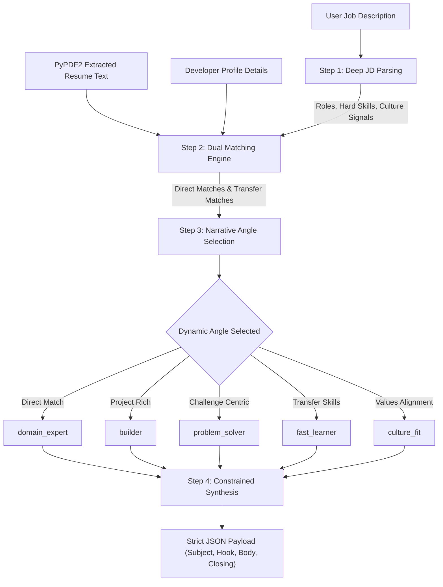

### Ingestion of Resume Multi-Modal Context
When the developer uploads a PDF resume, `mailer.gemini.draft_email` extracts the raw structural text using `PyPDF2`:
```python
if use_resume and profile.resume:
    try:
        import PyPDF2
        with open(profile.resume.path, 'rb') as f:
            reader = PyPDF2.PdfReader(f)
            resume_text = "\n".join(page.extract_text() for page in reader.pages if page.extract_text())
    except Exception as e:
        logger.warning(f"Failed to read resume PDF: {e}")
```
This parsed text is injected directly into the Gemini prompt under `=== RESUME DETAILS ===`, allowing Gemini to cite specific open-source repositories, university projects, metrics, and achievements.

### Strict JSON Output Contract
The model is instructed to output raw JSON adhering to this schema:
```json
{
  "subject": "Role Application — Candidate Name",
  "greeting": "Dear Hiring Team at Company Name,",
  "hook": "Concise 1-2 sentence hook proving value immediately.",
  "body": "2-3 targeted paragraphs addressing JD requirements directly.",
  "why_company": "1-2 sentences on company-specific engineering missions.",
  "closing": "Call to action referencing attached resume.",
  "sign_off": "Warm regards,\nCandidate Name",
  "jd_skills_matched": ["Django", "React", "PostgreSQL"],
  "angle_used": "builder"
}
```

### Deterministic Algorithmic Fallback
If the user's Gemini API quota is exhausted, the network drops, or JSON validation fails, the system executes `_build_default()`. This algorithmic fallback constructs a clean, personalized pitch using the developer's graduation year, college, skills array, and bio—ensuring the application workflow is never interrupted.

---

## 🎨 6. Responsive HTML Templating Engine

ProReach avoids plain, easily ignorable plain-text emails by providing **6 hand-crafted, production-tested HTML email themes**. Every theme is designed with inline CSS compatible with all major email clients (Gmail, Apple Mail, Outlook).

### Email Theme Catalog

| Theme ID | Name | Visual Aesthetic | Target Industry / Recipient |
| :--- | :--- | :--- | :--- |
| `theme1` | **Void Purple** | Sleek dark mode, purple gradients, modern developer styling | Startups, Web3, AI & Cutting-Edge Tech |
| `theme2` | **Editorial Ink** | High-contrast editorial style, clean borders, serif accents | Creative Agencies, Design Studios, Publications |
| `theme3` | **Soft Bento** | Bento card containers, emerald accents, rounded geometry | Product Companies, SaaS, FinTech |
| `theme4` | **Neobrutalist** | High-contrast borders, bold shadows, retro tech aesthetic | Indie Hackers, Creative Tech, Gaming Studios |
| `theme5` | **Newsletter Dark** | Clean digest layout, subtle divider lines, deep slate tones | Engineering Blogs, Media, Open-Source Teams |
| `theme6` | **Minimal Resume** | Clean monochromatic structure, executive resume look | Enterprise, Fortune 500, Financial Institutions |

### In-App Mobile WebView Preview
Before transmitting an email, candidates can tap **"Preview Theme"** in the mobile app. The React Native app invokes `POST /api/v1/compose/preview/`, which renders the template server-side and returns the full HTML payload. The client displays it within a modal `WebView`, allowing candidates to inspect their email layout prior to dispatch.

---

## ⚡ 7. Asynchronous Non-Blocking Dispatch & Concurrency

### The Latency Problem
Connecting to `smtp.gmail.com:587`, executing TLS handshakes, authenticating credentials, assembling multi-part MIME packets, and streaming binary PDF attachments takes anywhere from **1.5 to 5.0 seconds**. Blocking the HTTP request thread during this process freezes the mobile client and degrades user experience.

### The Background Worker Thread Pattern
ProReach delegates email transmission to an isolated daemon worker thread:

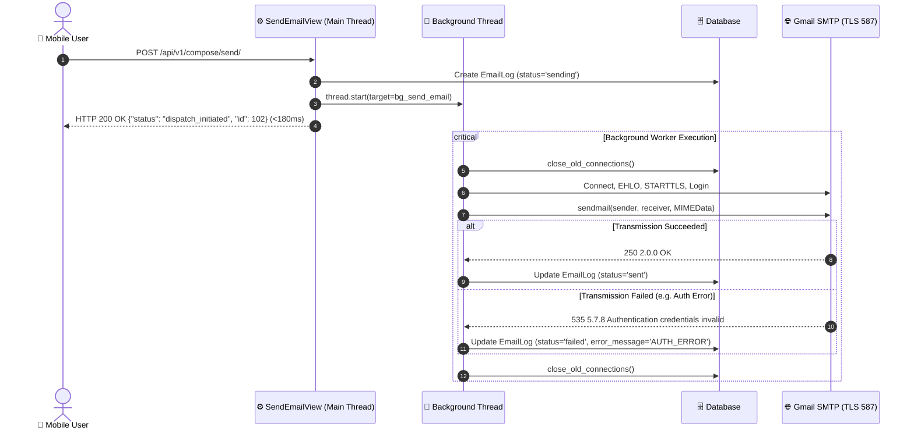

### Database Connection Hygiene
In Django, background threads retain references to database connections opened by the spawning thread. In multi-threaded environments, this can lead to connection leaks or `OperationalError: SSL error: decryption failed or bad record mac`. 

ProReach resolves this by invoking `django.db.close_old_connections()`:
1. Immediately upon entering the background worker thread.
2. In the `finally` block before the thread terminates.

```python
def bg_send_email():
    from django.db import close_old_connections
    close_old_connections()  # Discard inherited connections
    try:
        success, msg = send_job_email(...)
        log.status = 'sent' if success else 'failed'
        log.error_message = '' if success else msg
        log.save()
    finally:
        close_old_connections()  # Release worker socket
```

---

## 📊 8. Application Lifecycle & Funnel State Machine

ProReach provides an integrated **Application Funnel Tracker** allowing developers to follow cold emails through every milestone of the recruiting cycle.

### Application State Machine

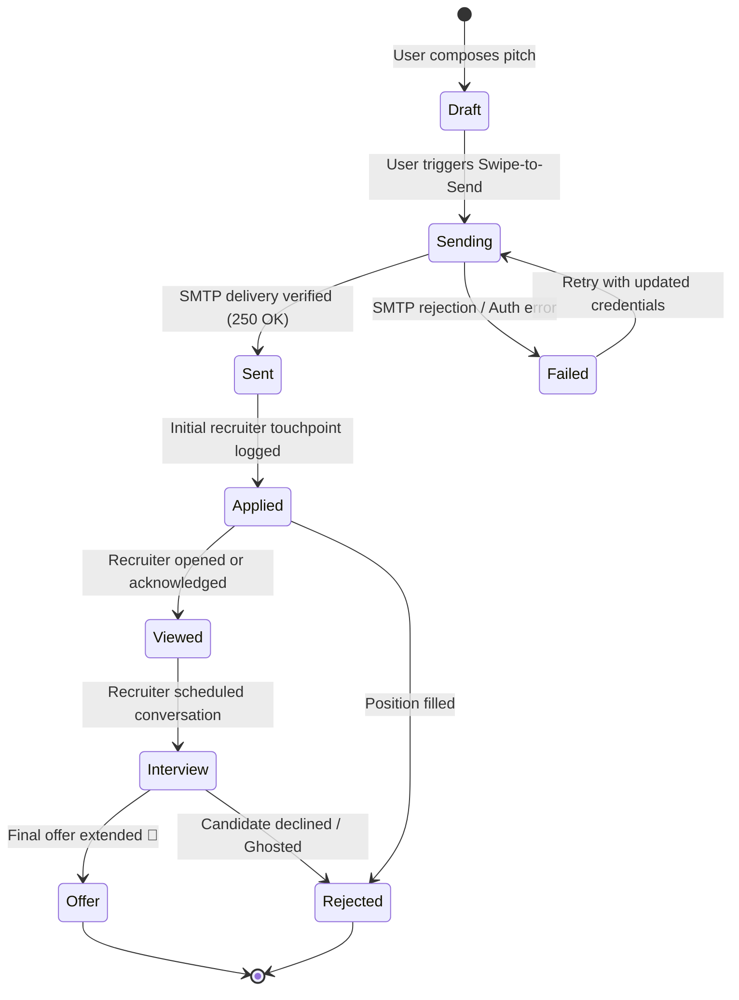

### Real-Time Delivery Polling
While the email sends in the background, the mobile client's `HistoryScreen` uses TanStack Query with an active polling interval (`refetchInterval: 2000`) to track status updates. Once the server marks the record as `sent` or `failed`, the UI automatically displays the updated badge without requiring a manual refresh.

### Circular Goal Dial & Motivation Engine
On the home dashboard, an interactive SVG ring tracks daily outreach targets:

$$\text{Progress} = \min\left(\frac{\text{Pitches Sent Today}}{\text{Daily Pitch Goal}}, 1.0\right)$$

$$\text{StrokeDashOffset} = \text{Circumference} \times (1 - \text{Progress})$$

---

## 📡 9. Complete REST API Specification

Base Endpoint: `https://job-email-app.onrender.com/api/v1/`  
Mandatory Header for Protected Endpoints: `X-Profile-ID: <UUID>`

### Endpoint Directory

| Method | Endpoint | Description | Auth Required |
| :--- | :--- | :--- | :--- |
| `POST` | `/profiles/create/` | Provision a new device-bound UUID profile | No |
| `GET` | `/profiles/me/` | Retrieve candidate profile, skills, & credential status | Yes |
| `PATCH` | `/profiles/me/` | Update candidate bio, skills, credentials, or resume | Yes |
| `GET` | `/companies/` | Retrieve candidate's saved company address book | Yes |
| `POST` | `/companies/` | Save a new company recruiter contact | Yes |
| `GET` | `/companies/<id>/` | Fetch single company record | Yes |
| `PATCH` | `/companies/<id>/` | Update contact notes or email | Yes |
| `DELETE` | `/companies/<id>/` | Delete company record | Yes |
| `GET` | `/history/` | List all dispatched emails & funnel statuses | Yes |
| `PATCH` | `/history/<id>/` | Update application stage (`Applied`, `Interview`, etc.) | Yes |
| `DELETE` | `/compose/history/bulk/` | Batch delete email history records | Yes |
| `POST` | `/compose/generate/` | Synthesize context-aware pitch via Gemini | Yes |
| `POST` | `/compose/preview/` | Render full responsive HTML email theme | Yes |
| `POST` | `/compose/send/` | Initiate background asynchronous SMTP dispatch | Yes |

### Endpoint Schemas & Payloads

#### 1. Generate Pitch (`POST /api/v1/compose/generate/`)
* **Request Payload**:
```json
{
  "company_name": "Stripe",
  "job_description": "We are seeking a Backend Engineer with strong Python and API design experience...",
  "about_company": "Fintech infrastructure leader",
  "use_resume": true
}
```
* **Response Payload (200 OK)**:
```json
{
  "subject": "Application for Software Engineer — Gautam",
  "greeting": "Dear Stripe Engineering Team,",
  "hook": "I have long admired Stripe's developer-first API design and want to bring my backend engineering background to your core infrastructure.",
  "body": "Having built production-grade Django APIs with dynamic cryptography...",
  "why_company": "Stripe's commitment to reliability and clean abstractions aligns directly with my engineering values.",
  "closing": "My resume is attached for your review. I look forward to connecting.",
  "sign_off": "Warm regards,\nGautam",
  "full_body": "Dear Stripe Engineering Team,\n\nI have long admired...",
  "jd_skills_matched": ["Python", "REST APIs", "PostgreSQL"],
  "angle_used": "domain_expert",
  "ai_used": true
}
```

#### 2. Dispatch Email (`POST /api/v1/compose/send/`)
* **Request Payload**:
```json
{
  "company_name": "Stripe",
  "receiver_email": "recruiting@stripe.com",
  "subject": "Application for Software Engineer — Gautam",
  "html_body": "Dear Stripe Engineering Team,\n\n...",
  "theme_used": "theme1",
  "ai_used": true
}
```
* **Response Payload (200 OK)**:
```json
{
  "status": "Email dispatch initiated",
  "message": "Sending in background",
  "id": 104
}
```

---

## 🗃️ 10. Relational Data Model & Entity Specifications

The persistence schema is engineered around tenant isolation, where all personal records, history items, and address books reference the primary `Profile` entity.

### Entity-Relationship Diagram

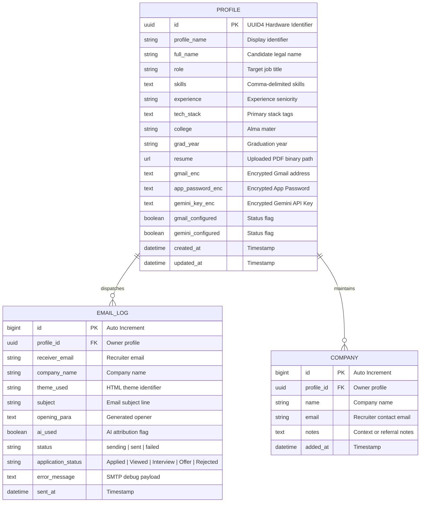

---

## 📱 11. Mobile Client Architecture & UX System

The client is built with **React Native** and **Expo**, engineered to deliver a fluid 60 FPS mobile experience.

### Architectural Highlights
1. **Bento-Grid Design Language**: Modular card components (`BentoCard.tsx`) group related functionality into clean, scannable panels.
2. **Dual-Theme Design System**: Supports both dark and light modes through a custom token-based provider (`useAppTheme()`).
3. **Gesture-Driven Interactions**:
   * **Swipe-to-Send**: A custom swipe slider built with `react-native-gesture-handler` and `react-native-reanimated` spring physics prevents accidental dispatches.
   * **Animated Tone Slider**: An interactive segmented track smoothly transitions between *Professional*, *Friendly*, and *Direct* tones.
4. **Resilient Local Caching**: Powered by **TanStack Query**, cached profiles and logs render instantly upon app launch while network revalidation runs quietly in the background.

```
┌────────────────────────────────────────────────────────────────────────┐
│                        DESIGN TOKEN PALETTE                            │
├────────────────────┬────────────────────┬──────────────────────────────┤
│ Token              │ Dark Theme         │ Light Theme                  │
├────────────────────┼────────────────────┼──────────────────────────────┤
│ Background         │ #000000            │ #F2F2F7                      │
│ Card Surface       │ #1C1C1E            │ #FFFFFF                      │
│ Text Primary       │ #FFFFFF            │ #000000                      │
│ Text Secondary     │ #8E8E93            │ #8E8E93                      │
│ Neon Cyan Accent   │ #00F0FF            │ #00F0FF                      │
│ Emerald Accent     │ #00FF66            │ #00FF66                      │
│ Border Stroke      │ #38383A            │ #E5E5EA                      │
└────────────────────┴────────────────────┴──────────────────────────────┘
```

---

## 🔮 12. Cross-Platform Ecosystem & Future Roadmap

Because the Django REST API is fully decoupled, ProReach is engineered to scale seamlessly beyond mobile devices.

### Ecosystem Topology

<div align="center">
  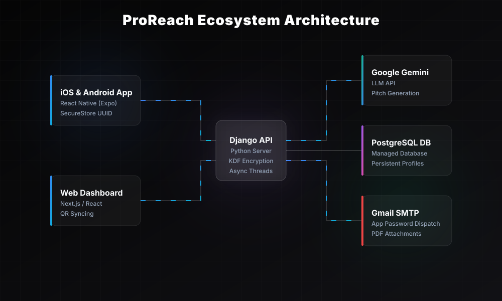
</div>

### Future Web Dashboard Port

<div align="center">
  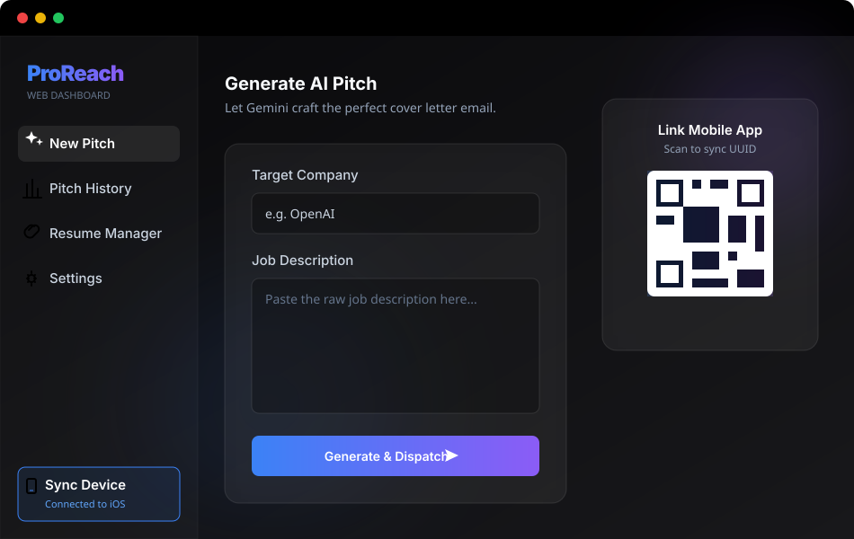
</div>

### Planned Cross-Platform Syncing (Mobile ↔ Web)
To synchronize accounts across devices without introducing traditional email/password logins:
1. The mobile app renders a secure **Sync QR Code** encoding the user's `UUID`.
2. The user scans the code using the ProReach web dashboard.
3. The web client stores the UUID in `localStorage`, instantly pairing the devices to the same backend record.

---

## 🏗️ 13. Infrastructure Scaling & Persistence Migration Plan

> [!WARNING]
> **Ephemeral Storage Notice:** When hosted on free-tier container platforms (like Render's free tier), the local filesystem is ephemeral. Server updates or redeployments wipe local storage, including SQLite database files (`db.sqlite3`).

### Ephemeral Storage vs. Production Architecture

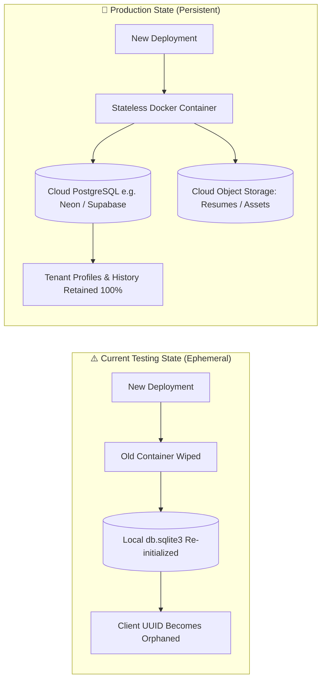

### Production Migration Roadmap

| Milestone | Implementation Strategy | Impact |
| :--- | :--- | :--- |
| **1. Managed Database** | Configure `DATABASE_URL` targeting a managed Cloud PostgreSQL instance (Neon / Supabase). | Completely eliminates data loss on server restarts. |
| **2. Distributed Task Queue** | Replace Python threading with **Celery + Redis**. | Adds job retry logic, rate-limit throttling, and scheduled follow-ups. |
| **3. Cloud Object Storage** | Route `profile.resume` uploads to Amazon S3 or Google Cloud Storage via `django-storages`. | Keeps resumes persistent across container lifecycles. |
| **4. Rate Limiting & Throttling** | Add DRF throttling scopes per `X-Profile-ID` to prevent SMTP abuse. | Protects Gmail accounts from triggering Google bulk-spam flags. |

---

## 💻 14. Local Development & Environment Setup

### Prerequisites
* **Python 3.10+**
* **Node.js 18+ & npm**
* **Expo Go** app on a physical device, or an Android/iOS emulator

### 1. Repository Setup
```bash
git clone https://github.com/gautam1432002/Job-Email-App.git
cd Job-Email-App
```

### 2. Backend Setup (Django REST Framework)
```bash
cd backend/jobmailer
python -m venv venv

# Activate virtual environment:
# Windows:
venv\Scripts\activate
# macOS/Linux:
# source venv/bin/activate

pip install -r requirements.txt
python manage.py migrate
python manage.py runserver 0.0.0.0:8000
```

### 3. Frontend Setup (React Native / Expo)
```bash
cd frontend
npm install

# For local testing, configure backend endpoint in .env:
# EXPO_PUBLIC_API_URL=http://<YOUR_LOCAL_IP>:8000/api/v1/

npx expo start --clear
```

### 4. Running Backend Unit Tests
```bash
cd backend/jobmailer
python manage.py test mailer.api_tests
```

---

<div align="center">
  <p><b>ProReach</b> was engineered with passion to demonstrate production-grade system architecture, dynamic security, and human-centric developer workflows.</p>
  <p>Made with ❤️ by Gautam</p>
</div>
